# Omarchy Kirisame Theme

Kirisame (霧雨, "misty rain") is a muted slate and mist-blue theme for Omarchy/Hyprland, built on a `#232829` base with soft pastel colors. It ships matching terminal, shell, editor, and app colors plus twelve wallpapers.

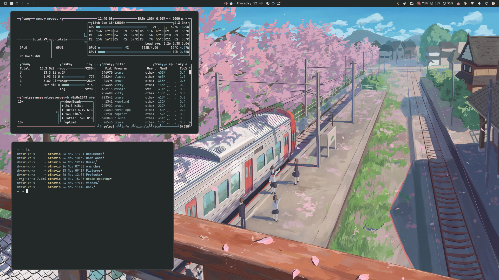

Kirisame is a rebuild of [Amekoji](https://github.com/atif-1402/omarchy-amekoji-theme) by atif-1402 for Omarchy 4. It keeps the slate background and the mist-blue accent, and was rewritten from scratch around `colors.toml`.

## Requirements

Omarchy 4 (Quattro) or newer.

## Install

```bash
omarchy-theme-install https://github.com/othavi0/omarchy-kirisame-theme
```

The installer clones the theme and applies it. To come back to it later, pick Kirisame in the theme menu or run:

```bash
omarchy-theme-set kirisame
```

Pull new versions with `omarchy-theme-update`, and uninstall with `omarchy-theme-remove kirisame`.

## Palette

Kirisame keeps Amekoji's slate and mist blue, and separates the status colors so red, yellow and green read as different hues while staying pastel. Body text sits at 10.4:1 over the background, muted text at 4.3:1, and selected text at 6.9:1 over the selection.

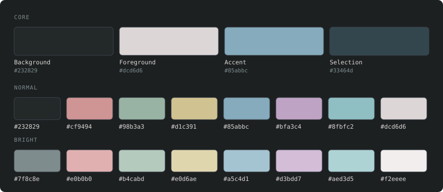

## What's included

`omarchy-theme-set kirisame` applies all of these on its own.

- `colors.toml` is the source Omarchy generates from. That covers the terminals (Alacritty, Kitty, Ghostty, Foot), the active and inactive Hyprland window borders, the omarchy-shell surfaces (bar, notifications, popups), btop, the Chromium frame, the Neovim, VS Code, Helix and Obsidian themes, Qt apps, and the keyboard backlight.
- `shell.menu.toml` and `shell.launcher.toml` give the omarchy-shell menu and launcher a darker solid card, a mist-blue gradient border and a mist-blue selected row.
- `shell.lock.toml` and `shell.tooltip.toml` make the lock screen input and the tooltips fully solid.
- `backgrounds/` holds the twelve wallpapers below.

## Rounded corners and transparency

Kirisame is drawn for rounded windows, solid surfaces, and a terminal that is only slightly see-through. A theme installed from git cannot change window shape or opacity, because Omarchy drops any `*.lua` file from it. Set both once with Omarchy's own commands:

```bash
omarchy hyprland corners rounded
omarchy hyprland window transparency transparent
```

`transparent` is the Omarchy default. It keeps every window solid except the terminal and a few small utility apps, which sit at about 98% opacity when focused and 96% otherwise. Use `opaque` to make the terminal solid too. The omarchy-shell menus follow the Hyprland corner radius on their own.

Both settings stay active when you switch to another theme. Undo them with `omarchy hyprland corners theme`.

## Wallpapers

Click any thumbnail for the full-resolution file.

| | | |
| --- | --- | --- |
| [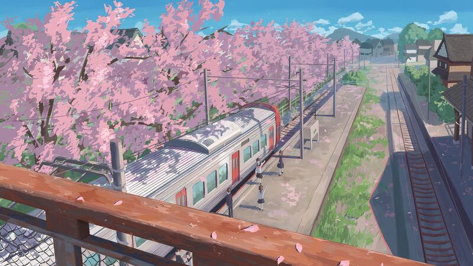](backgrounds/01-sakura-line.jpg) | [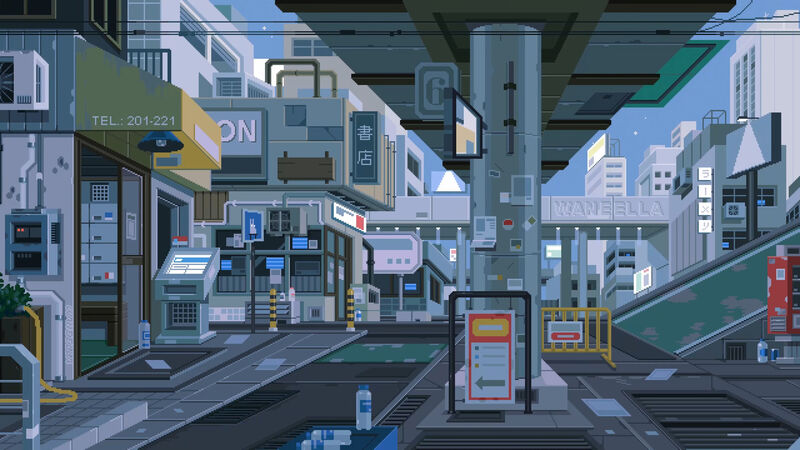](backgrounds/02-pixel-station.jpg) | [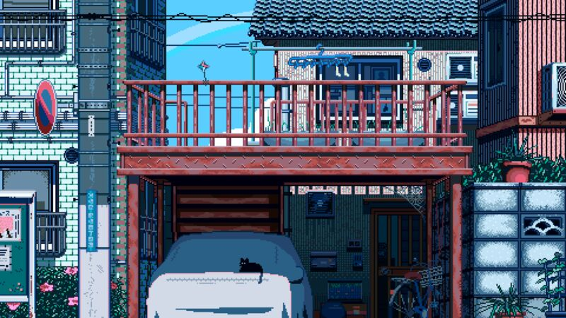](backgrounds/03-balcony-cat.png) |
| `01-sakura-line.jpg` | `02-pixel-station.jpg` | `03-balcony-cat.png` |
| [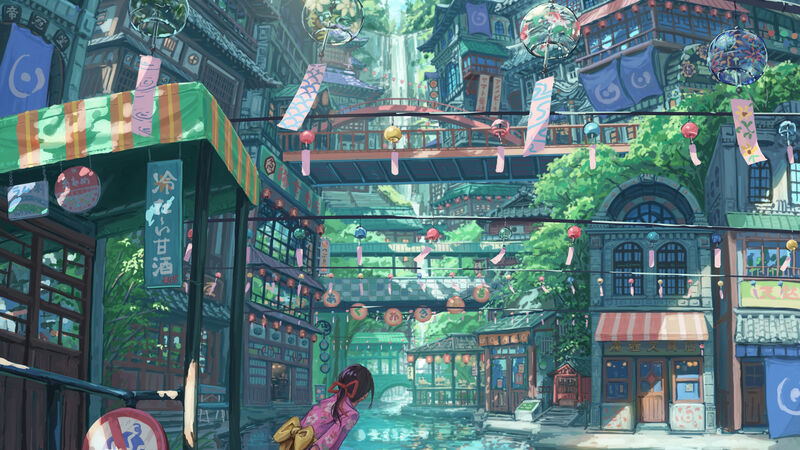](backgrounds/04-overgrown-arcade.jpg) | [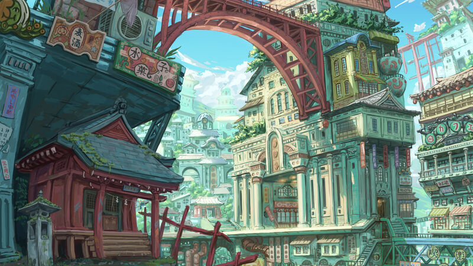](backgrounds/05-jade-town.jpg) | [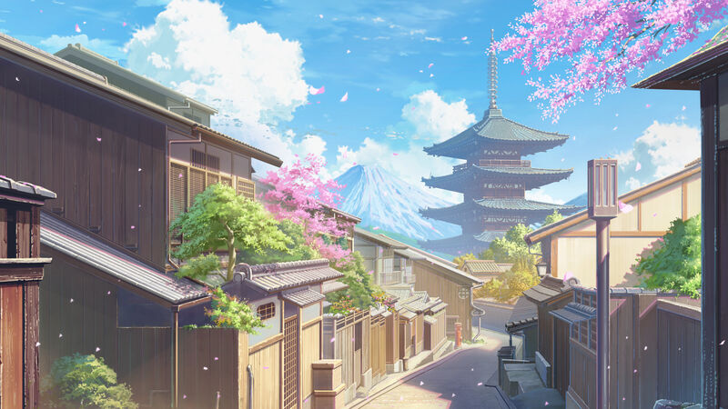](backgrounds/06-pagoda-street.jpg) |
| `04-overgrown-arcade.jpg` | `05-jade-town.jpg` | `06-pagoda-street.jpg` |
| [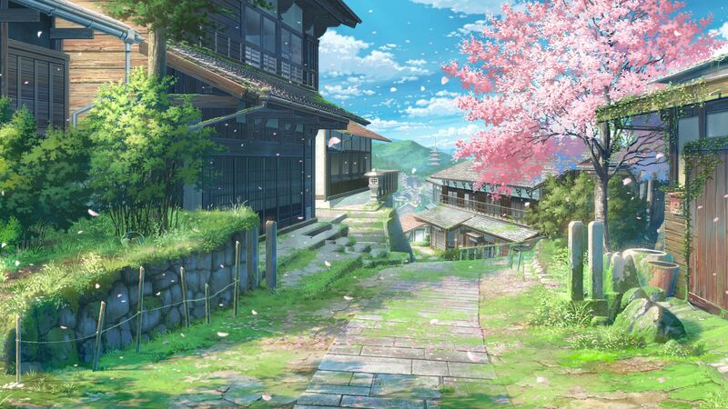](backgrounds/07-village-path.jpg) | [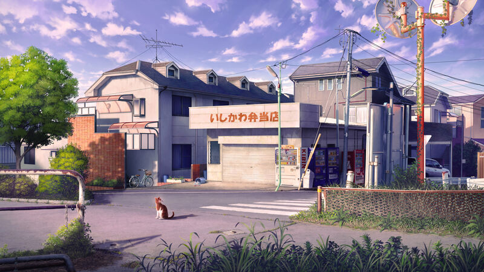](backgrounds/08-bento-corner.jpg) | [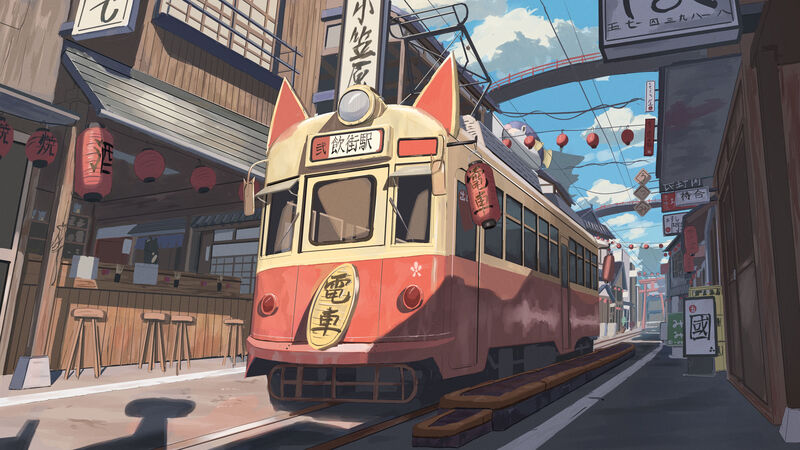](backgrounds/09-cat-tram.jpg) |
| `07-village-path.jpg` | `08-bento-corner.jpg` | `09-cat-tram.jpg` |
| [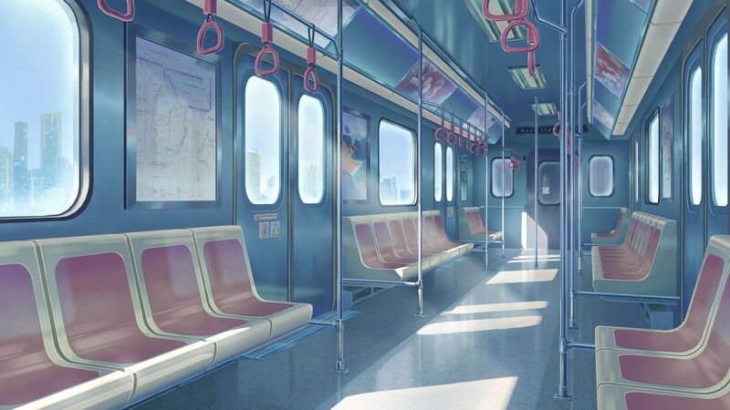](backgrounds/10-empty-carriage.jpg) | [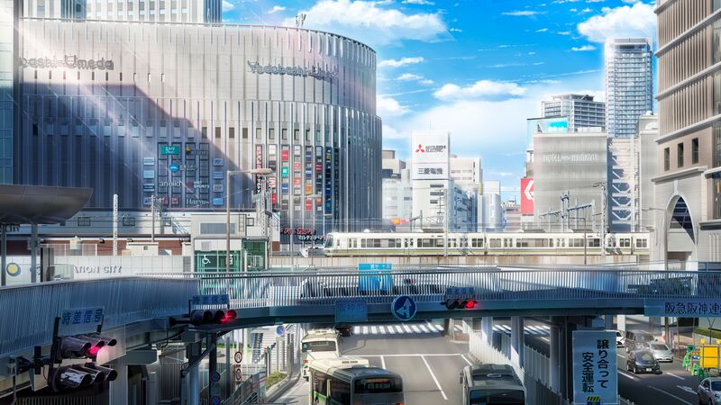](backgrounds/11-city-overpass.jpg) | [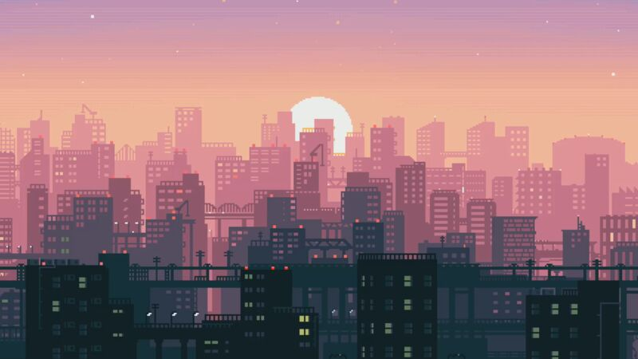](backgrounds/12-rose-skyline.png) |
| `10-empty-carriage.jpg` | `11-city-overpass.jpg` | `12-rose-skyline.png` |

### Wallpaper sources

The wallpapers are third-party artwork found on Wallhaven, and they are not covered by any license of this repository. If one of them is yours and you want it credited or removed, open an issue.

- `01-sakura-line.jpg`: <https://wallhaven.cc/w/zp9q7y>
- `02-pixel-station.jpg`: <https://wallhaven.cc/w/o3l26l>
- `03-balcony-cat.png`: <https://wallhaven.cc/w/2y6zl6>
- `04-overgrown-arcade.jpg`: <https://wallhaven.cc/w/vq81j3>
- `05-jade-town.jpg`: <https://wallhaven.cc/w/wezkgx>
- `06-pagoda-street.jpg`: <https://wallhaven.cc/w/jeepom>
- `07-village-path.jpg`: <https://wallhaven.cc/w/yqq6rd>
- `08-bento-corner.jpg`: <https://wallhaven.cc/w/x6vved>
- `09-cat-tram.jpg`: <https://wallhaven.cc/w/qro3kr>
- `10-empty-carriage.jpg`: <https://wallhaven.cc/w/21kgog>
- `11-city-overpass.jpg`: <https://wallhaven.cc/w/9od8kw>
- `12-rose-skyline.png`: <https://wallhaven.cc/w/vg52ql>

## Changing the palette

Every color lives in `colors.toml`. After editing it, redraw the palette image above:

```bash
python3 scripts/gen_palette.py
```

The `shell.*.toml` files repeat a few of those colors by hand, so update them in the same change.
